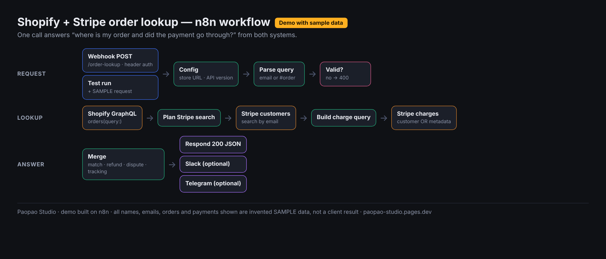
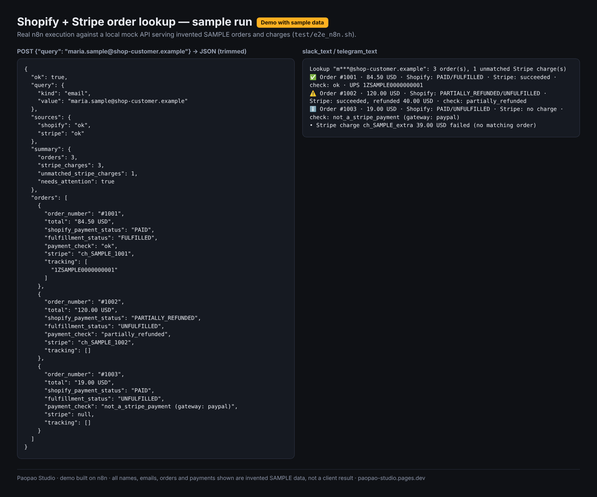

# Shopify + Stripe order lookup (n8n workflow)

A webhook that answers *“where is my order and did the payment go through?”* in one call. Send a customer email or an order number. The workflow looks up the order in the **Shopify Admin GraphQL API** and the payment in **Stripe**, then returns merged JSON:

- payment, refund and dispute status;
- fulfillment and tracking;
- a `payment_check` verdict;
- ready-to-post `slack_text` and `telegram_text` for a support bot or helpdesk.

> **Demo with sample data.** Screenshots and outputs come from an invented store, customers and charges, served by a local mock API. They are not a client result.



```
Webhook POST /order-lookup ─┐
Test run ─> Sample request ─┴─> Config ─> Parse query ─> Valid? ─no─> Respond 400
                                                          │yes
Shopify GraphQL orders(query) ─> Plan Stripe search ─> Stripe customers/search (email)
 ─> Build charge query ─> Stripe charges/search (customer OR metadata order no.) ─> Merge ─> Respond 200 (+ optional Slack / Telegram)
```

Core n8n nodes only. Tested on n8n 2.45.6.

## Request / response

```bash
curl -X POST https://YOUR-N8N/webhook/order-lookup \
  -H 'X-Api-Key: <your secret>' -H 'Content-Type: application/json' \
  -d '{"query": "#1001"}'          # or {"query": "customer@example.com"}
```

Response (shape, abridged; real SAMPLE output in `test/e2e_output.SAMPLE.json`):

```json
{
  "ok": true,
  "query": { "kind": "order_number", "value": "#1001" },
  "sources": { "shopify": "ok", "stripe": "ok" },
  "summary": { "orders": 1, "stripe_charges": 1, "unmatched_stripe_charges": 0, "needs_attention": false },
  "orders": [{
    "order_number": "#1001", "total": "84.50 USD", "shopify_payment_status": "PAID", "fulfillment_status": "FULFILLED",
    "tracking": [{ "company": "UPS", "number": "1Z…", "url": "…" }],
    "stripe": { "charge_id": "ch_…", "matched_by": "metadata", "status": "succeeded", "refunded": "0.00 USD", "disputed": false },
    "payment_check": "ok"
  }],
  "unmatched_stripe_charges": [],
  "slack_text": "…", "telegram_text": "…"
}
```

`payment_check` values:

- `ok`
- `partially_refunded`, `refunded`, `disputed`
- `payment_failed` / `payment_pending`
- `amount_mismatch`
- `stripe_charge_not_found`
- `not_a_stripe_payment (gateway: …)`: for example PayPal or Shop Pay via Shopify Payments.

Customer emails are masked in the chat texts. If one API is down, the call still answers from the other, and `ok: false` names the failing source.

## Setup

1. Import `shopify_stripe_order_lookup.workflow.json`.
2. **Shopify:** create a custom app (Settings → Apps → Develop apps) with the `read_orders` scope. Orders older than 60 days also need `read_all_orders`. Add an n8n **Shopify Access Token API** credential with the Admin API access token.
3. **Stripe:** create a **restricted key** with read access to Customers and Charges only. Add an n8n **Stripe API** credential.
4. **Webhook auth:** add a **Header Auth** credential (for example `X-Api-Key`) on the webhook. Do not leave this endpoint open, because it returns customer order data.
5. Open **Config**: set `shopifyBaseUrl` to `https://<store>.myshopify.com`.
   - `stripeOrderMetadataKey` (default `order_number`): if your checkout writes the order number into Stripe charge metadata, set the key name here.
   - `maxOrders` (default 5).
6. Click **Test workflow** (uses the *Sample request (SAMPLE)* node), then activate. Optionally enable the Slack / Telegram nodes.

### Why HTTP Request nodes and not the built-in Shopify/Stripe nodes

The built-in nodes cannot search orders by email or order name, or charges by customer/metadata. Shopify's REST Admin API is legacy, and the GraphQL Admin API is the supported path. The HTTP Request nodes still use n8n's stored **Shopify** and **Stripe** credentials, so no keys sit in the workflow.

### How charges are matched

Stripe's charge search cannot filter by email. So the workflow:

1. finds Stripe customers by email (from the request, or from the Shopify order when you sent an order number);
2. searches charges by `customer:"cus_…" OR metadata["order_number"]:"1001"`.

A charge is attached to an order when its metadata carries the order number. Otherwise it is attached when it was made by the same customer, for the same amount and currency, within 3 days.

Limits:
- Guest charges with no Stripe customer and no order metadata cannot be found by email.
- Stripe search results can lag a few seconds behind new payments.
- Shopify Payments orders are not Stripe charges on your account, and are reported as `not_a_stripe_payment`.

## Verified

- `node test/unit_test.js` runs the four Code nodes, taken from the workflow JSON, on `test/sample_data.SAMPLE.js`. It covers:
  - an email lookup returning 3 orders: matched by metadata, matched by email + amount + date (partially refunded), and a PayPal order, plus one unmatched failed charge;
  - an order-number lookup with a disputed charge;
  - invalid input → 400;
  - order not found;
  - Stripe outage → answer still returned with `sources.stripe = error`.
- `bash test/e2e_n8n.sh` runs the **real workflow in n8n 2.45.6** (CLI `import:credentials`, `import:workflow`, `execute`) against `test/mock_server.js`, a local stand-in for Shopify GraphQL and Stripe search serving SAMPLE data. The mock rejects requests without the right `X-Shopify-Access-Token` / `Authorization: Bearer` headers, so the test also proves n8n's stored credentials are applied. The result is written to `test/e2e_output.SAMPLE.json`.
- `test/validate_nodes.js` checks node types, versions and connections against `n8n-nodes-base`.
- Not run against a live store: that needs a real Shopify store and Stripe account.



## Files

- `shopify_stripe_order_lookup.workflow.json`: the importable workflow (generated by `build_workflow.py` from `src/*.js`)
- `src/`: Code node sources
- `test/`: SAMPLE data, mock API, unit test, n8n end-to-end test, SAMPLE outputs
- `docs/`: diagram and sample-output screenshots

## Want it wired into your helpdesk?

Paopao Studio connects this to your store, your Stripe account and your support channel (Slack, Telegram, Gorgias, Zendesk…), and hands it over documented.
https://paopao-studio.pages.dev/?utm_source=github&utm_medium=readme&utm_campaign=demo_order_lookup

License: MIT
